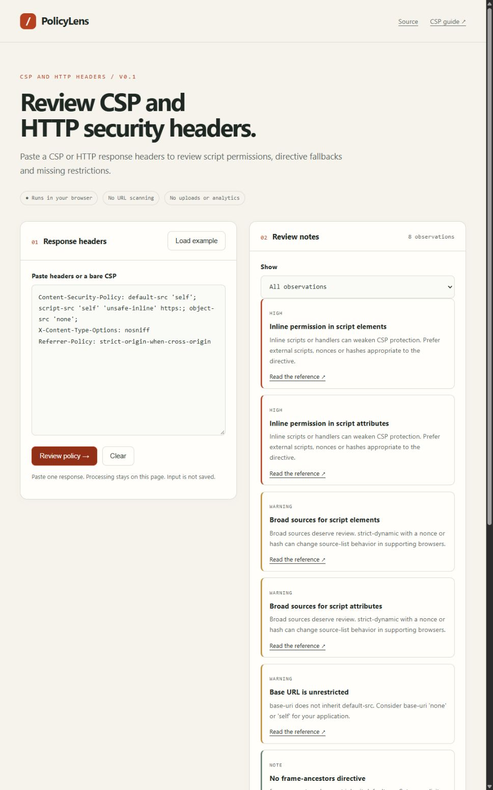

# PolicyLens

Paste a Content Security Policy or HTTP response headers to review script
permissions, directive fallbacks and missing restrictions. Each finding links
to the relevant documentation. All processing happens in the browser.

[Open the workbench](https://rogfog.github.io/PolicyLens/) · [Design notes, RU](docs/design.ru.md)



## What it checks

- Script-source fallbacks, broad source lists, inline permissions and unsafe-eval.
- Repeated directives (first occurrence wins) and mixed `'none'` source lists.
- Explicit base-uri, frame-ancestors and form-action restrictions.
- Presence of an enforcing CSP, nosniff and contextual transport/referrer notes.
- Multiple policies and Report-Only are called out rather than silently merged.

Processing happens entirely in your browser. No URL scanner, uploads, cookies,
analytics, persistence or runtime dependencies. JSON reports are downloaded locally.

## Run locally

Requires Node.js 24+ and npm.

```sh
npm ci --ignore-scripts
npm test
npm run dev
```

Open http://127.0.0.1:4173. `npm run build` writes the static site to `dist/`.

## Example

```http
Content-Security-Policy: default-src 'self'; script-src 'self' 'unsafe-inline'; object-src 'none'
X-Content-Type-Options: nosniff
Referrer-Policy: strict-origin-when-cross-origin
```

Review the inline-script permission and the missing base-uri restriction. A
default-src policy does not restrict base-uri, form-action or frame-ancestors.

## Limits

This is a focused static review, not a complete CSP parser or a certification.
Checks review individual policies; another enforced policy may mitigate a note.
Comma-separated policy lists are identified but not analyzed. Nonces, hashes,
browser compatibility and application behavior require additional context.
HSTS notes do not establish that the pasted response was served over HTTPS.
Test changes with your application before enforcement; do not paste credentials.

## Development

The analyzer is independent of the DOM. Tests cover fallback behavior, duplicate
directives, Report-Only, multiple policies and input limits. CI tests and builds
pull requests; the Pages workflow publishes tested builds from main.

See [open tasks](https://github.com/ROGFOG/PolicyLens/issues) for the next steps.

References: [MDN CSP](https://developer.mozilla.org/en-US/docs/Web/HTTP/Reference/Headers/Content-Security-Policy),
[CSP Level 3](https://www.w3.org/TR/CSP3/).

MIT license.
